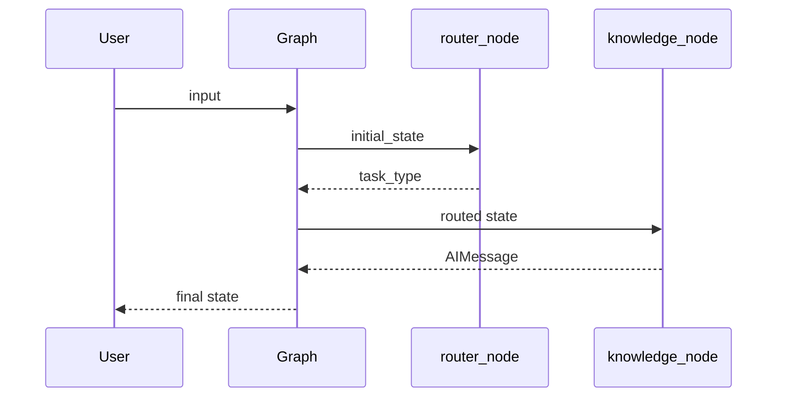

# 第 1 周请求执行追踪

## 这个文件的作用

TRACE 可以理解为“一次请求的行车记录仪”。测试通常只告诉我们最终结果对不对；TRACE 用来说明结果是怎样一步步产生的。

当前文件先完成**静态预演**：根据源码推导应该走哪条路径。等离线 graph 可以运行后，再把静态预演与真实执行输出对照。两者一致，才算理解和验证。

它不是日志框架，不要求背模板，也不要求现在学习 OpenTelemetry。

- 日期：2026-10-01
- 输入：`bind_tools 有什么作用？`
- 是否调用外部模型：否
- request/thread 标识：`week01-trace-local-knowledge`
- 当前证据类型：静态源码预演，尚未运行 graph

## 时序图

## 状态变化

| 步骤 | 节点/边 | 读取字段 | 写入字段 | 分支理由 | 潜在失败 |
| ---: | --- | --- | --- | --- | --- |
| 1 | START | 无 | 创建 `messages/user_input/task_type/error/llm_calls` | 所有 graph 调用从 START 进入 | 初始状态缺字段或类型错误 |
| 2 | `router_node` | `user_input`、`llm_calls` | `task_type=local_knowledge`、`llm_calls=0` | 输入包含 `bind_tools` 关键词 | 关键词规则误判；字段缺失 |
| 3 | conditional edge | `task_type` | 不修改状态 | `route_by_task_type` 将 `local_knowledge` 映射到 `knowledge_node` | 映射遗漏或拼写不一致 |
| 4 | `knowledge_node` | `user_input` | 追加一个 `AIMessage` | 调用本地 `search_local_knowledge`，不需要 LLM | 知识表未命中；工具调用异常 |
| 5 | END | 完整状态 | 不修改状态 | `knowledge_node` 有直接到 END 的边 | 最终状态不符合调用方预期 |

## 最终检查

- 初始消息数：1（HumanMessage）
- 预期最终消息数：2（HumanMessage + AIMessage）
- 预期最终 `task_type`：`local_knowledge`
- 预期最终 `llm_calls`：0，因为没有调用模型
- 预期走过的节点：`START → router_node → knowledge_node → END`

## 可观测性缺口

1. 目前没有每个节点的开始、结束和耗时记录；
2. 没有一个统一 request ID 贯穿打印输出；
3. 规则路由为什么命中某个关键词没有被结构化记录。

## 不应记录的数据

- API Key；
- 完整个人隐私或敏感对话；
- 未处理的异常中可能包含的认证信息。

## 我的解释

为什么选择该路由：输入包含 `bind_tools`，在 `router_node` 的本地知识关键词列表中，因此被分类为 `local_knowledge`。

如果失败，最先检查 `router_node` 是否正确写入 `task_type`，再检查 conditional edge 映射，最后检查本地知识工具是否命中。

哪个测试可以保护这条路径：一个路由单元测试验证该输入得到 `local_knowledge`；一个知识节点测试验证返回消息包含 `bind_tools` 对应解释。

## 你需要亲自完成的部分

1. 用自己的话解释“测试”和“trace”的差别；
2. 在离线 graph 可运行后记录真实结果；
3. 比较真实结果与上面预期是否一致；
4. 如果不一致，记录差异而不是修改预期来迎合结果。
