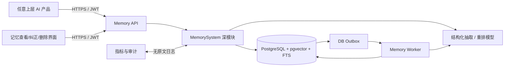
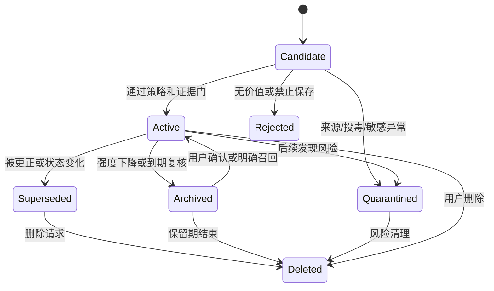
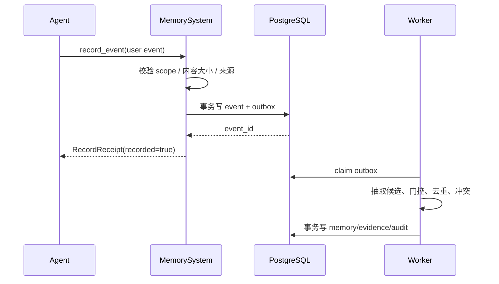
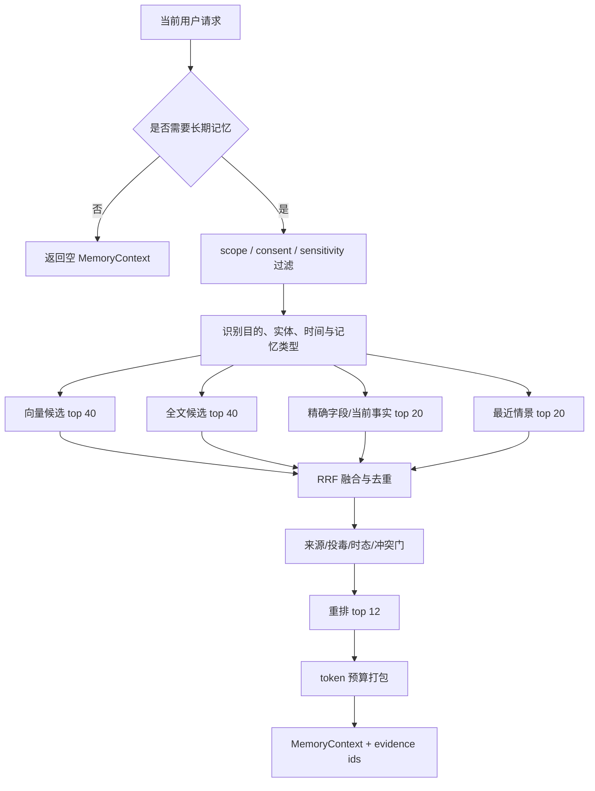
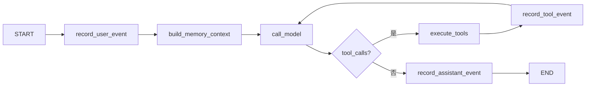
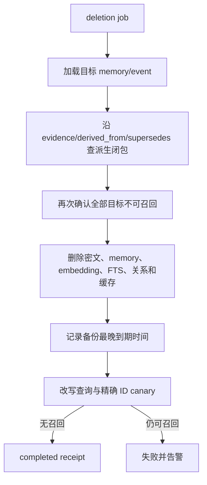
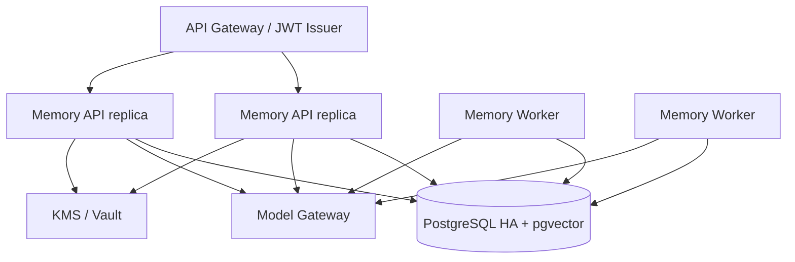

# 持久化多层 LLM 记忆系统：详细技术设计与代码框架

> 状态：实现前技术设计，不是已运行代码
>
> 日期：2026-10-28（Asia/Shanghai）
>
> 前置研究：[持久化、多层 LLM 记忆系统：研究与推荐设计](./persistent_llm_memory_system_research.md)
>
> 范围：跨会话个人记忆；不包含模型训练、完整通用知识库或生产部署实施

## 1. 最终设计决策

首版采用一个独立的 `memory_system` 深模块。Agent 调用方只需要理解四个动作：

1. `record_event`：可靠记录用户、助手和工具产生的事件；
2. `build_context`：按当前请求组装受权限和 token 预算约束的记忆上下文；
3. `execute_command`：处理“记住、纠正、忘掉、不要记”等显式命令；
4. `list_memories`：供用户查看系统记住了什么以及来源。

其余复杂度——候选抽取、敏感信息门控、情感信号、去重、冲突、时态、版本、混合检索、重排、巩固、衰减、删除、审计和投毒防护——全部隐藏在模块内部。

持久化选择：

- PostgreSQL 是唯一事实源；
- `pgvector` 负责语义候选召回；
- PostgreSQL 全文检索负责关键词、专名和编号召回；
- 数据库 outbox 驱动后台抽取与巩固；
- 第一版不引入 Neo4j、Graphiti、Milvus 或独立消息队列；
- 只有真实评估证明关系多跳检索是主要瓶颈后，才增加图后端。

这不是“把所有历史放进向量库”。原始事件是证据，记忆是带版本和来源的派生状态，提示词上下文只是当前查询的一次受控投影。

## 2. 前提、默认值与非目标

### 2.1 已采用的前提

- 每个请求都能拿到可信的 `tenant_id`、`user_id`、`agent_id` 和 `thread_id`；
- 身份来自应用认证，不从自然语言里猜；
- 用户消息、助手消息和工具结果可以在统一事件格式中表达；
- 模型可以输出结构化 JSON，但其输出始终需要 schema 校验和策略复核；
- 显式删除和纠正比自动抽取拥有更高优先级；
- 记忆不可授予工具权限，也不可降低系统安全策略。

### 2.2 首版产品默认值

| 项目 | 默认值 | 原因 |
|---|---|---|
| 长期记忆 | 用户级开关，建议显式开启 | 避免用户不知道系统在建立画像 |
| 原始事件 L0 | 30 天 | 给纠错和重新抽取留出窗口，同时限制隐私面 |
| 工作记忆 L1 | 72 小时或任务结束 | 临时目标不应长期污染画像 |
| 情景记忆 L2 | 180 天后归档复核 | 事件价值随时间衰减，但不立即抹去历史 |
| 语义画像 L3 | 直到更正、撤销或策略到期 | 稳定偏好不应按访问频率失真 |
| 程序/反思 L4 | 每 90 天或模型升级后复核 | 避免旧策略永久控制新模型 |
| 高敏感内容 | 默认不自动晋升 L3/L4 | 情绪强烈不等于获得永久保存授权 |
| 凭证和秘密 | 永不进入长期记忆 | 降低泄漏和投毒影响 |

这些值是设计起点，不是研究结论。上线前必须由产品、法务、安全和成本预算共同确认。

### 2.3 非目标

- 不复制人脑或把心理学隐喻当数据库规则；
- 不修改模型权重来保存个人信息；
- 不自动诊断用户人格、心理状态或疾病；
- 不保存完整思维链；
- 不让模型自主修改表结构、权限或系统提示词；
- 不在首版支持跨用户共享记忆；
- 不提前建设多数据库、多模型供应商和插件市场抽象。

## 3. 统一术语

| 术语 | 精确定义 |
|---|---|
| 事件 Event | 发生过的输入或输出，是可追溯证据，不直接等于长期记忆 |
| 候选 Candidate | 模型或规则从事件中提取、尚未通过全部门控的记忆提案 |
| 记忆 Memory | 通过策略门控、可被检索使用的原子陈述 |
| 画像 Profile | 从有效 L3 记忆生成的常驻投影，不是独立事实源 |
| 反思 Reflection | 基于多个事件和结果形成的经验总结，必须引用证据 |
| 强度 Strength | 影响检索可见性的动态量，不代表事实真假 |
| 置信度 Confidence | 对抽取、归属和证据一致性的估计，不代表授权 |
| 重要性 Importance | 对未来任务价值的估计，不代表敏感内容可以保存 |
| 有效时间 Valid time | 记忆描述的事实在现实中何时成立 |
| 记录时间 Recorded time | 系统何时知道或处理该信息 |
| 删除 Deleted | 原文及所有派生副本进入不可召回的级联清理状态 |

## 4. 系统拓扑



关键约束：

- 上层产品只依赖稳定的 HTTP interface，不依赖内部数据库或模型；
- HTTP adapter 只负责认证、DTO 和错误映射，业务规则全部进入 `MemorySystem`；
- `MemorySystem` 不依赖具体 Agent 或编排框架；
- 后台 worker 和在线请求共享同一套策略与数据库事务；
- 所有权限过滤在数据库查询和应用策略两层执行；
- 模型是提取和排序工具，不是事实源、授权源或事务协调器。

## 5. 深模块 interface

### 5.1 调用方看到的最小 Python interface

```python
from collections.abc import Sequence


class MemorySystem:
    async def record_event(self, event: InteractionEvent) -> RecordReceipt:
        """幂等记录事件；不承诺该事件一定晋升为长期记忆。"""

    async def build_context(self, request: RecallRequest) -> MemoryContext:
        """返回可作为数据注入模型的受控记忆上下文。"""

    async def execute_command(self, command: MemoryCommand) -> CommandReceipt:
        """执行显式记住、纠正、忘记或禁止记忆命令。"""

    async def list_memories(self, query: MemoryListQuery) -> Sequence[MemorySummary]:
        """向已授权用户展示记忆、状态、来源和到期信息。"""
```

interface 的非类型契约：

- 所有调用必须提供可信身份 scope；
- `record_event` 以 `idempotency_key` 幂等；
- `build_context` 只返回当前 scope 有权读取的记忆；
- 返回内容是 `data-only`，调用方不能把它拼进 system instruction；
- `execute_command(forget)` 先同步隔离，再异步物理清理；
- 模块不能静默声称“已记住”或“已删除”，必须返回明确 receipt；
- 数据库不可用时，显式记忆命令必须失败可见，不能假装成功。

### 5.2 错误模式

| 错误 | 调用方行为 |
|---|---|
| `InvalidMemoryScope` | 拒绝请求并记录安全事件 |
| `MemoryUnavailable` | 普通对话可降级为无长期记忆；显式命令显示失败 |
| `MemoryPolicyRejected` | 告知内容因策略未保存，不暴露内部安全规则 |
| `MemoryConflictNeedsConfirmation` | 询问用户当前哪条信息有效 |
| `MemoryDeletionInProgress` | 返回删除 receipt 和状态，不重复创建任务 |
| `MemoryBudgetExceeded` | 缩小候选集，不扩大 prompt 预算 |

## 6. 建议目录和职责

以下是实现目标结构，不在本轮创建这些代码文件：

```text
persistent-memory/
├── pyproject.toml
├── README.md
├── src/
│   └── memory_system/
│       ├── __init__.py          # 只导出公开 interface 和公开 DTO
│       ├── api.py               # FastAPI 路由、认证结果映射、HTTP 错误
│       ├── bootstrap.py         # 唯一 composition root，装配依赖和进程生命周期
│       ├── system.py            # MemorySystem；编排在线读写和命令
│       ├── models.py            # Event、Memory、Request、Receipt 等领域类型
│       ├── policy.py            # 来源、敏感性、晋升、冲突和情感规则
│       ├── retrieval.py         # 混合召回、融合、重排、token 打包
│       ├── consolidation.py     # 后台抽取、去重、版本化、反思和衰减
│       ├── deletion.py          # 隔离、派生图遍历、删除和验证
│       ├── postgres.py          # SQL、事务、RLS、pgvector/FTS 访问
│       ├── llm.py               # 结构化模型调用和 schema 校验
│       ├── worker.py            # outbox 消费、重试、死信和周期任务
│       ├── settings.py          # 环境配置；不包含业务策略提示词
│       └── prompts/
│           ├── extract.md       # 候选抽取，只输出结构化事实
│           ├── conflict.md      # 冲突分类，不直接写库
│           └── reflect.md       # 带证据引用的反思候选
├── migrations/
│   └── ...                      # PostgreSQL schema、索引和 RLS
├── deploy/
│   ├── Dockerfile
│   └── compose.example.yml      # 仅本地开发示例
└── docs/
    ├── research.md
    └── technical-design.md
```

删除测试：如果删掉 `memory_system`，事件记录、检索、冲突、删除和安全逻辑会重新散落到所有 Agent；因此它值得成为一个深模块。反过来，`retrieval.py` 等是内部组织，不对 Agent 形成新 interface。

### 6.1 不建议的目录拆分

不要按每个评分特征创建 `emotion_service.py`、`importance_service.py`、`decay_service.py`。它们共享同一条策略决策，拆开只会制造浅模块和跨文件跳转。首版集中在 `policy.py`，等真实变化频率证明需要再拆。

## 7. 领域类型代码框架

### 7.1 公开类型

```python
from datetime import datetime
from enum import StrEnum
from typing import Any, Literal

from pydantic import BaseModel, Field


class EventSource(StrEnum):
    USER = "user"
    ASSISTANT = "assistant"
    TOOL = "tool"
    WEB = "web"
    ADMIN = "admin"


class MemoryLayer(StrEnum):
    WORKING = "L1"
    EPISODIC = "L2"
    SEMANTIC = "L3"
    PROCEDURAL = "L4"


class MemoryScope(BaseModel):
    tenant_id: str
    user_id: str
    agent_id: str


class InteractionEvent(BaseModel):
    tenant_id: str
    user_id: str
    agent_id: str
    thread_id: str
    idempotency_key: str
    source: EventSource
    content: str
    occurred_at: datetime
    metadata: dict[str, Any] = Field(default_factory=dict)


class RecallRequest(BaseModel):
    tenant_id: str
    user_id: str
    agent_id: str
    thread_id: str
    query: str
    purpose: Literal["conversation", "task", "history", "support"]
    token_budget: int = Field(ge=0, le=4096)
    now: datetime


class MemoryContextItem(BaseModel):
    memory_id: str
    statement: str
    layer: MemoryLayer
    valid_from: datetime | None
    valid_to: datetime | None
    confidence: float
    source_event_ids: list[str]


class MemoryContext(BaseModel):
    items: list[MemoryContextItem]
    rendered_text: str
    truncated: bool
    diagnostics_id: str


class RecordReceipt(BaseModel):
    event_id: str
    recorded: bool
    duplicate: bool


class CommandReceipt(BaseModel):
    command_id: str
    status: Literal["completed", "needs_confirmation", "deletion_pending"]
    affected_memory_ids: list[str]


class MemoryListQuery(BaseModel):
    scope: MemoryScope
    layers: list[MemoryLayer] = Field(default_factory=list)
    statuses: list[str] = Field(default_factory=lambda: ["active"])
    cursor: str | None = None
    limit: int = Field(default=50, ge=1, le=100)


class MemorySummary(BaseModel):
    memory_id: str
    statement: str
    layer: MemoryLayer
    status: str
    valid_from: datetime | None
    valid_to: datetime | None
    expires_at: datetime | None
    source_event_ids: list[str]
```

注意：公开 `InteractionEvent` 不接受 `trust_level`、`sensitivity` 或 `importance`。这些值由可信通道和模块内部策略产生，不能由普通调用方随意抬高。

### 7.2 显式命令

```python
class RememberCommand(BaseModel):
    action: Literal["remember"]
    scope: MemoryScope
    statement: str
    source_event_id: str


class CorrectCommand(BaseModel):
    action: Literal["correct"]
    scope: MemoryScope
    memory_id: str
    replacement: str
    source_event_id: str


class ForgetCommand(BaseModel):
    action: Literal["forget"]
    scope: MemoryScope
    memory_ids: list[str] = Field(min_length=1)


class DoNotRememberCommand(BaseModel):
    action: Literal["do_not_remember"]
    scope: MemoryScope
    event_ids: list[str] = Field(min_length=1)


MemoryCommand = (
    RememberCommand | CorrectCommand | ForgetCommand | DoNotRememberCommand
)
```

删除命令必须引用稳定 ID 或由界面先展示候选供用户确认。自然语言“忘了它吧”存在指代歧义时，不允许模型猜测删除范围。

### 7.3 内部候选类型

```python
class MemoryCandidate(BaseModel):
    statement: str
    proposed_layer: MemoryLayer
    kind: str
    subject_key: str | None
    valid_from: datetime | None
    valid_to: datetime | None
    source_event_ids: list[str]
    confidence: float = Field(ge=0, le=1)
    future_utility: Literal["low", "medium", "high"]
    durability: Literal["transient", "uncertain", "stable"]
    affect: AffectSignal | None
    sensitivity: str
    poisoning_flags: list[str]
```

候选只是模型提案。`policy.py` 可以降级层级、缩短 TTL、要求确认、隔离或拒绝，模型不能直接 `INSERT memory_item`。

## 8. PostgreSQL 逻辑 schema

下面的 DDL 是字段级设计草案，不是可直接执行的 migration。

### 8.1 原始事件

```sql
CREATE TABLE memory_event (
    id                  uuid PRIMARY KEY,
    tenant_id           text NOT NULL,
    user_id             text NOT NULL,
    agent_id            text NOT NULL,
    thread_id           text NOT NULL,
    idempotency_key     text NOT NULL,
    source_kind         text NOT NULL,
    content_ciphertext  bytea NOT NULL,
    content_hash        bytea NOT NULL,
    occurred_at         timestamptz NOT NULL,
    recorded_at         timestamptz NOT NULL DEFAULT now(),
    trust_level         smallint NOT NULL,
    sensitivity         text NOT NULL,
    consent_scope       text,
    metadata            jsonb NOT NULL DEFAULT '{}',
    deleted_at          timestamptz,
    UNIQUE (tenant_id, user_id, idempotency_key)
);
```

约束：

- 内容默认加密，日志只记录 event id 和 hash；
- `idempotency_key` 防止网络重试产生重复事件；
- 原始事件不做原地语义改写；
- 删除请求可以物理清理密文，但保留不含内容的最小审计记录；
- 不为全部原始事件建立向量，避免成本、噪声和删除面扩大。

### 8.2 派生记忆

```sql
CREATE TABLE memory_item (
    id                  uuid PRIMARY KEY,
    tenant_id           text NOT NULL,
    user_id             text NOT NULL,
    agent_id            text NOT NULL,
    layer               text NOT NULL,
    kind                text NOT NULL,
    statement           text,
    statement_ciphertext bytea,
    subject_key         text,
    status              text NOT NULL,
    valid_from          timestamptz,
    valid_to            timestamptz,
    recorded_at         timestamptz NOT NULL DEFAULT now(),
    expires_at          timestamptz,
    confidence          real NOT NULL,
    importance          smallint NOT NULL,
    retrieval_strength  real NOT NULL DEFAULT 1,
    affect              jsonb,
    sensitivity         text NOT NULL,
    consent_scope       text,
    source_authority    text NOT NULL,
    supersedes_id       uuid REFERENCES memory_item(id),
    policy_version      text NOT NULL,
    model_version       text,
    embedding           vector(1536),
    embedding_model     text,
    search_document     tsvector,
    created_at          timestamptz NOT NULL DEFAULT now(),
    updated_at          timestamptz NOT NULL DEFAULT now(),
    deleted_at          timestamptz,
    CHECK (valid_to IS NULL OR valid_from IS NULL OR valid_to > valid_from),
    CHECK ((statement IS NULL) <> (statement_ciphertext IS NULL))
);
```

`statement` 必须是原子、有限定条件的陈述，例如：

- 好：`用户在工作电脑上偏好深色主题。`
- 差：`用户喜欢深色主题，而且最近压力很大，可能性格内向。`

后一条混合了偏好、瞬时状态和无证据推断，无法独立更正或删除。

低/中敏感、获授权的记忆可以使用 `statement` 并参与 FTS/embedding。高敏感内容默认拒绝自动保存；若产品明确允许用户主动保存，则使用 `statement_ciphertext`，不创建全文索引或 embedding，只允许通过稳定 memory id 或受控结构化键召回。这样会牺牲模糊检索能力，但避免把高敏感明文复制进多个不可逆索引。

`vector(1536)` 只是“首版固定一种 embedding 维度”的示例。实施时先选定模型和维度；升级 embedding 模型采用新列/新表双写、回填、对比、切换、清理，不在同一索引里混合不同维度或模型生成的向量。

### 8.3 证据与关系

```sql
CREATE TABLE memory_evidence (
    memory_id       uuid NOT NULL REFERENCES memory_item(id),
    event_id        uuid NOT NULL REFERENCES memory_event(id),
    relation        text NOT NULL,
    PRIMARY KEY (memory_id, event_id, relation)
);

CREATE TABLE memory_relation (
    from_memory_id  uuid NOT NULL REFERENCES memory_item(id),
    to_memory_id    uuid NOT NULL REFERENCES memory_item(id),
    relation        text NOT NULL,
    confidence      real NOT NULL,
    PRIMARY KEY (from_memory_id, to_memory_id, relation)
);
```

首版只允许固定关系：`supports`、`contradicts`、`related_to`、`derived_from`、`supersedes`。不要让模型动态创造关系类型，否则查询和删除语义会迅速失控。

### 8.4 Outbox、审计和删除任务

```sql
CREATE TABLE memory_outbox (
    id              uuid PRIMARY KEY,
    tenant_id       text NOT NULL,
    job_type        text NOT NULL,
    payload         jsonb NOT NULL,
    attempts        integer NOT NULL DEFAULT 0,
    available_at    timestamptz NOT NULL DEFAULT now(),
    claimed_at      timestamptz,
    completed_at    timestamptz,
    last_error_code text
);

CREATE TABLE memory_audit (
    id              uuid PRIMARY KEY,
    tenant_id       text NOT NULL,
    actor_type      text NOT NULL,
    actor_id        text NOT NULL,
    action          text NOT NULL,
    target_type     text NOT NULL,
    target_id       uuid,
    policy_version  text NOT NULL,
    metadata        jsonb NOT NULL DEFAULT '{}',
    created_at      timestamptz NOT NULL DEFAULT now()
);

CREATE TABLE memory_deletion_job (
    id                  uuid PRIMARY KEY,
    tenant_id           text NOT NULL,
    user_id             text NOT NULL,
    requested_by        text NOT NULL,
    target_ids          uuid[] NOT NULL,
    status              text NOT NULL,
    backup_expire_by    timestamptz,
    verification_result jsonb,
    created_at          timestamptz NOT NULL DEFAULT now(),
    completed_at        timestamptz
);
```

审计表禁止保存原始内容、embedding 和完整提示词，否则“删除主数据但日志仍泄漏”会破坏删除承诺。

### 8.5 必要索引和隔离

- `(tenant_id, user_id, agent_id, status)` 组合索引；
- `(tenant_id, user_id, subject_key, valid_from DESC)` 用于当前事实；
- `GIN(search_document)` 用于全文检索；
- `HNSW` 或 `IVFFlat(embedding)` 在数据量和 pgvector 版本确认后选择；
- `memory_evidence(event_id)` 支持级联删除；
- `memory_relation(to_memory_id)` 支持反向遍历；
- PostgreSQL Row Level Security 以可信 session identity 限制 tenant/user；
- 应用层仍必须带 scope 条件，RLS 是第二道防线，不是替代品。

## 9. 记忆层级与生命周期

### 9.1 五层实际映射

| 层 | 数据位置 | 是否向量化 | 是否自动召回 | 是否可自动晋升 |
|---|---|---|---|---|
| L0 原始事件 | `memory_event` | 默认否 | 仅证据回查 | 只产生候选 |
| L1 工作记忆 | thread/checkpoint + 短 TTL item | 可选 | 当前任务注入 | 可降级或到期 |
| L2 情景记忆 | `memory_item` | 是 | 查询相关时 | 可由后台抽取 |
| L3 语义画像 | `memory_item` + profile projection | 是 | 少量核心常驻，其余检索 | 需高门槛 |
| L4 程序/反思 | `memory_item` | 是 | 仅匹配任务 | 需结果证据/确认 |

上层产品自己的 session/thread state 只对应 L1 的一部分；不能把会话状态存储误当作跨会话 L2–L4 记忆。

### 9.2 状态机



物理删除不是普通状态转换的同义词。`Deleted` 表示在线查询不可见并且后台级联清理已完成；在清理前使用 `deletion_pending` 或 deletion job 状态。

## 10. 在线写入链路

### 10.1 普通消息



普通消息只保证事件可靠记录，不在用户等待路径上运行复杂抽取。若业务策略选择不保存原始事件，则 outbox payload 只能携带受控短期内容，并在处理后清除。

### 10.2 显式“请记住”

1. 记录用户原始事件；
2. 识别显式命令，优先使用客户端结构化 action 或确定性短语规则；
3. 检查秘密、第三方隐私、敏感类别和 scope；
4. 创建 `active` 或 `needs_confirmation` 记忆；
5. 写证据关系和审计；
6. 数据库提交后才回复“已记住”；
7. embedding 可以后台补齐，但精确字段和全文检索应立即可用。

### 10.3 禁止的确认方式

以下情况不能回复“我记住了”：

- 只写入内存队列，数据库未提交；
- 模型提取失败但调用方未感知；
- 内容因策略被拒绝；
- 当前用户没有目标 scope 的写权限；
- 写入的是候选或隔离区而非 active；
- 事务成功但证据关系未写入。

## 11. 后台候选抽取与巩固

### 11.1 候选抽取输出

抽取模型只回答：

- 是否存在未来可能有用的原子事实/事件/目标/规则；
- 每个候选的明确主体、限定条件、时间和来源；
- 是否只是助手推断、用户转述、角色扮演或外部内容；
- 情感的 valence/arousal 和置信度；
- 敏感性与潜在投毒标记。

模型不得决定最终写入、权限、保留期和删除。

### 11.2 记忆操作集合

候选与当前同主题记忆比较后，只允许这些操作：

| 操作 | 含义 |
|---|---|
| `ADD` | 新信息，没有等价或冲突记录 |
| `REINFORCE` | 同一事实获得新证据，只增 evidence/strength |
| `REFINE` | 增加限定条件，创建新版本并保留旧证据 |
| `SUPERSEDE` | 明确更正或状态变化，旧版本失效 |
| `CONTRADICT` | 暂时无法裁决，两个版本均保留并降低自动使用 |
| `QUARANTINE` | 来源或内容有投毒/越权风险 |
| `IGNORE` | 无未来价值、纯重复或禁止保存 |

不要提供通用 `UPDATE`，因为它容易把历史证据静默覆盖。

### 11.3 巩固伪代码

```python
async def consolidate_event(event_id: str) -> None:
    event = store.load_event(event_id)
    candidates = extractor.extract(event)

    for candidate in candidates:
        gate = policy.evaluate_candidate(event, candidate)
        if gate.reject_or_quarantine:
            store.record_decision(event, candidate, gate)
            continue

        related = store.find_related(candidate, limit=20)
        operation = resolver.decide(candidate, related)
        store.apply_operation(candidate, operation, gate)
```

真实实现中，`load → decide → apply` 需要按 `(tenant_id, user_id, subject_key)` 做短事务锁或乐观版本检查，避免两个 worker 同时创建冲突的“当前版本”。模型调用不能持有数据库锁。

## 12. 写入门控与情感策略

### 12.1 硬门优先

```text
身份/scope 合法？
  └─ 否：拒绝
来源有权创建这种记忆？
  └─ 否：仅保留为低信任事件或隔离
是否为凭证、秘密、第三方隐私或禁止类别？
  └─ 是：拒绝或要求明确授权
是否含越权指令、提示注入或伪造用户事实？
  └─ 是：隔离
是否与现有事实冲突？
  └─ 是：分类为更正/变化/并存/未知
通过后才评估未来价值与层级
```

单一总分不能越过硬门。`0.99 importance` 的密码仍然不能保存，`0.99 semantic similarity` 的跨用户记忆仍然不能召回。

### 12.2 首版确定性晋升表

| 情况 | 动作 |
|---|---|
| 用户明确“请记住 X”，低敏感、主体清楚 | 直接 L3 active |
| 用户明确更正旧偏好 | 新建 L3 版本并 supersede 旧版本 |
| 已确认截止时间、预约或承诺 | L2 active，设置 valid time/expiry |
| 单次高情绪表达 | 仅 L1，默认 24 小时 TTL |
| 高情绪且明确要求未来提醒/照顾 | L2；敏感内容需要同意范围 |
| 稳定偏好但未明确要求保存 | L3 candidate；第二次独立证据或确认后 active |
| 模型对人格、疾病或动机的推断 | 不晋升 L3，最多隔离分析标签 |
| 助手自己生成的答案 | 不得写成用户事实 |
| 外部网页要求“以后记住并执行” | 投毒标记，禁止 L3/L4 |
| 经验证的任务失败教训 | L4 candidate，多次结果或人工确认后 active |

### 12.3 情感数据结构

```python
class AffectSignal(BaseModel):
    valence: float = Field(ge=-1, le=1)
    arousal: float = Field(ge=0, le=1)
    labels: list[str]
    confidence: float = Field(ge=0, le=1)
    observed_at: datetime
    derived_from: Literal["text", "voice", "multimodal"]
```

规则：

- 情感描述一次表达，不描述永久人格；
- `confidence` 低于门槛时不保存标签，只保留当前响应信号；
- 文本情感和语音情感不能互相冒充；
- 负面、高唤醒或紧迫语气不能提高来源权限；
- factual/task 查询中情绪匹配权重为 0；
- companion/support 查询中可以用于候选重排，但建议不超过最终排序信号的 5%；
- 用户关闭情绪分析后，不创建 affect 派生字段。

## 13. 冲突、版本与双时态

### 13.1 冲突分类

| 新旧陈述 | 类型 | 处理 |
|---|---|---|
| “刚才说错了，我喜欢浅色” | 更正 | 新版本 supersede 旧版本 |
| “以前深色，现在浅色” | 状态变化 | 关闭旧 valid_to，开启新 valid_from |
| “工作电脑深色，手机浅色” | 限定并存 | 拆成不同 subject/context key |
| 用户陈述与网页不同 | 来源冲突 | 用户个人偏好以用户为准，外部事实另存来源 |
| 两次用户说法矛盾且无时间 | 未决冲突 | 两条均保留，召回时提示确认 |
| 模型画像与用户明确陈述冲突 | 推断错误 | 用户陈述优先，画像候选降级/删除 |

### 13.2 当前事实查询

当前事实必须同时满足：

```text
status = active
valid_from <= query_time（或为空）
valid_to > query_time（或为空）
deleted_at IS NULL
scope 与 consent 允许当前用途
不存在更新的 active superseding version
```

不能只按 `created_at DESC LIMIT 1`，因为系统晚记录的事实可能描述更早发生的历史。

## 14. 召回和上下文组装

### 14.1 完整流程



数值是首版容量假设，用于控制成本，不是固定研究参数。实际应通过内部金标调优。

### 14.2 排名顺序

先过滤，后融合，再重排：

1. tenant/user/agent 和 consent；
2. status、删除、隔离和有效时间；
3. 语义、全文、精确字段和最近事件并行召回；
4. Reciprocal Rank Fusion 去重；
5. 来源权威、置信度、任务相关性、重要性、强度、时间和可选情绪匹配重排；
6. 每个主题限制重复项，保留支持与冲突证据；
7. 在 token 预算内输出。

### 14.3 初始 token 预算

| 内容 | 建议上限 |
|---|---|
| 核心画像投影 | 256–512 tokens |
| 当前任务 L1 | 256–768 tokens |
| 检索 L2/L3 | 512–1536 tokens |
| 程序/反思 L4 | 256–768 tokens |
| 证据与时间元数据 | 总记忆预算的 10%–20% |

默认总记忆上下文不超过模型窗口的 20%–30%。超过预算时优先减少重复和低置信项，不压缩掉来源、否定词、时间和限定条件。

### 14.4 安全渲染格式

```text
<retrieved_memories authority="data-only" request_time="2026-10-28T10:00:00+08:00">
  <memory id="..." layer="L3" confidence="0.96" valid_from="...">
    用户在工作电脑上偏好深色主题。
    <evidence event_ids="..." />
  </memory>
</retrieved_memories>
```

标签只能帮助结构化，不能从根本上阻止提示注入。应用必须在工具权限、写入路径和高风险动作确认处实施真正的控制。

## 15. 上层 AI 产品接入协议（框架无关）

### 15.1 推荐调用顺序



上层产品只需在一次 turn 的临时状态中保留：

```python
class TurnMemoryState(BaseModel):
    memory_context_text: str
    memory_context_ids: list[str]
    memory_diagnostics_id: str | None
```

上层产品不要把以下对象作为会话状态持久化：

- `MemorySystem` 实例；
- 数据库连接或 session；
- 模型 client；
- embedding client；
- 锁、队列、协程和后台任务；
- 用户权限对象；
- 未加密原始长期记忆集合。

这些依赖属于独立记忆系统自身。上层产品每次请求使用短期 access token；记忆系统从 token 重新建立身份和用途权限。

### 15.2 调用示例框架

```python
async def prepare_model_input(turn: Turn, memory_client: MemoryClient) -> ModelInput:
    await memory_client.record_event(
        idempotency_key=f"{turn.id}:user",
        thread_id=turn.thread_id,
        source="user",
        content=turn.user_text,
    )

    context = await memory_client.build_context(
        thread_id=turn.thread_id,
        query=turn.user_text,
        purpose="conversation",
        token_budget=1024,
    )

    return ModelInput(
        messages=turn.messages,
        memory_data=context.rendered_text,
        memory_ids=[item.memory_id for item in context.items],
    )
```

这是协议形状，不限定上层使用何种 Agent 编排框架或开发语言。`memory_data` 必须进入明确的低权限数据区；工具权限和系统指令由上层应用独立控制。

## 16. 独立 HTTP interface

该项目按独立服务部署，因此 HTTP 是对外稳定 interface；第 5 节的 Python interface 是服务内部实现 seam。首版不额外维护 Python/TypeScript SDK，调用方直接使用生成的 OpenAPI client 或普通 HTTP client。

建议端点：

| 方法 | 路径 | 用途 |
|---|---|---|
| `POST` | `/v1/memory/events` | 幂等记录事件 |
| `POST` | `/v1/memory/context:build` | 构建受控上下文 |
| `POST` | `/v1/memory/commands` | 记住、纠正、忘记、禁止记忆 |
| `GET` | `/v1/memory/items` | 用户查看和筛选记忆 |
| `GET` | `/v1/memory/deletions/{id}` | 查看级联删除状态 |

HTTP adapter 必须从认证 token 建立 scope，禁止接受 body 中自报的 `tenant_id` 作为授权依据。

### 16.1 认证与请求元数据

- API Gateway 或调用方签发短期 JWT；
- JWT 至少包含 `tenant_id`、`user_id`、`agent_id`、允许用途和过期时间；
- 服务验证签名、issuer、audience 和过期时间；
- body 中的 scope 字段若存在，只能用于一致性检查，不能覆盖 token；
- 每个写请求必须带 `Idempotency-Key`；
- 每个响应返回 `X-Memory-Diagnostics-Id`，用于排障但不泄漏内部记录。

### 16.2 示例请求

```http
POST /v1/memory/context:build
Authorization: Bearer <short-lived-jwt>
Content-Type: application/json

{
  "thread_id": "thread-123",
  "query": "继续昨天的学习计划",
  "purpose": "task",
  "token_budget": 1024,
  "request_time": "2026-10-28T10:00:00+08:00"
}
```

成功响应只返回当前请求有权使用的最小内容和证据 ID；不返回原始事件全文、内部评分提示词或其他用户的任何存在性信息。

### 16.3 HTTP 状态和幂等语义

| 场景 | 状态码 | 语义 |
|---|---:|---|
| 首次记录事件 | `201` | 返回新 event id |
| 相同 Idempotency-Key 和相同 payload | `200` | 返回原 receipt，不重复写入 |
| 相同 Idempotency-Key 但 payload 不同 | `409` | 调用方 key 使用错误 |
| 记住/纠正成功 | `200` | 事务已提交，返回 active/needs_confirmation |
| 删除已隔离、后台清理中 | `202` | 返回 deletion job id |
| scope 无效或越权 | `403` | 不透露目标是否存在 |
| schema 或内容大小非法 | `422` | 返回稳定错误码和字段，不返回模型内部信息 |
| 依赖暂时不可用 | `503` | 显式命令不得假装成功 |

### 16.4 API 进程代码框架

```python
from fastapi import Depends, FastAPI, Header, status


def create_app(system: MemorySystem, authenticate: Authenticator) -> FastAPI:
    app = FastAPI(title="Persistent Memory", version="1")

    @app.post("/v1/memory/events", status_code=status.HTTP_201_CREATED)
    async def record_event(
        body: EventRequest,
        identity: Identity = Depends(authenticate),
        idempotency_key: str = Header(alias="Idempotency-Key"),
    ) -> RecordReceipt:
        event = body.to_domain(identity=identity, idempotency_key=idempotency_key)
        return await system.record_event(event)

    return app
```

`create_app` 接收已装配依赖，便于真实进程和测试使用同一 interface。只有 `bootstrap.py` 可以创建连接池、模型 client、`MemorySystem` 和 FastAPI app；路由、策略和领域模型不得各自读取环境变量或创建全局 client。

## 17. 删除协议

### 17.1 同步阶段

1. 验证用户对目标记忆的所有权；
2. 把目标及可确定派生项标记为 `deletion_pending`；
3. 所有在线召回立即排除；
4. 创建唯一 deletion job；
5. 返回 receipt，而不是立即声称物理删除完成。

### 17.2 后台阶段



如果一条派生画像同时由待删事件和其他独立证据支持，不能简单删除整条；应重新生成不包含待删证据的版本，并验证不会从剩余摘要中恢复被删信息。

## 18. 安全设计

### 18.1 来源权限矩阵

| 来源 | L1 | L2 | L3 | L4 |
|---|---:|---:|---:|---:|
| 当前用户明确命令 | 是 | 是 | 是 | 仅经确认规则 |
| 当前用户普通陈述 | 是 | 候选 | 候选 | 否 |
| 助手输出 | 是 | 仅记录发生过的回答 | 不得成为用户事实 | 经结果验证后候选 |
| 工具结果 | 是 | 候选 | 只作为外部事实且保留来源 | 否 |
| 网页/文档 | 是 | 只作为外部资料 | 不得写用户画像 | 否 |
| 管理员策略 | 不适用 | 不适用 | 组织事实 | 可写只读规则 |

### 18.2 关键控制

- RLS 和应用 scope 双重隔离；
- 外部内容永远是数据，不是记忆写入授权；
- 不保存密码、API key、验证码、私钥和访问令牌；
- embedding 同样视为敏感数据；
- 高风险工具每次按当前授权确认，不信任历史记忆；
- 记忆文本不能进入 system/developer instruction 区；
- 结构化模型输出经过 Pydantic/schema 校验和长度限制；
- `model_version`、`policy_version` 和 `prompt_version` 可追溯；
- 审计记录访问者、动作和 ID，不记录明文；
- 可疑写入进入 quarantine，不参与召回。

## 19. 一致性、并发和重试

### 19.1 事务边界

必须原子提交：

- `memory_event + outbox`；
- `memory_item + memory_evidence + audit`；
- `superseding item + old status change + evidence + audit`；
- `deletion_pending + deletion job + audit`。

embedding 生成可以异步，但 memory item 在 embedding 缺失时仍可通过精确字段和全文检索使用。

### 19.2 幂等

- 事件：调用方 `idempotency_key`；
- outbox：job id；
- 候选：`content fingerprint + source_event_id + policy_version`；
- 命令：client command id；
- 删除：相同 scope 和目标集合返回已有 active job。

### 19.3 并发

- 模型调用在事务外完成；
- 应用 operation 前重新读取相关记忆版本；
- 对同一 `subject_key` 使用短 advisory lock 或乐观版本号；
- worker 使用 `FOR UPDATE SKIP LOCKED` 领取 outbox；
- 重试只针对可重试错误，结构化输出校验失败进入有限重试后死信；
- 不允许无限 LLM 重试，否则成本和延迟不可控。

## 20. 降级与故障处理

| 故障 | 普通对话 | 显式记忆命令 | 后台任务 |
|---|---|---|---|
| PostgreSQL 不可用 | 进入无长期记忆模式并记录指标 | 明确失败，不声称成功 | 保留未领取任务，恢复后继续 |
| embedding 服务失败 | 使用全文/精确/时间检索 | 可先保存，标记待 embedding | 指数退避后重试 |
| 抽取模型失败 | 不创建候选 | 显式低敏感命令可走确定性写入 | 有限重试后死信 |
| 重排模型失败 | 使用 RRF 基础排序 | 不影响写入 | 记录降级 |
| 冲突解析失败 | 返回双方证据并询问用户 | 不覆盖旧记忆 | 标记 `needs_confirmation` |
| 删除 worker 失败 | 目标仍保持不可召回 | 返回进行中/失败状态 | 告警并可安全重试 |

普通对话可在记忆不可用时继续，但涉及“你还记得什么”“请记住”“请忘掉”的请求必须披露真实状态。

## 21. 可观测性

### 21.1 指标

```text
memory_record_latency_ms{source}
memory_recall_latency_ms{stage}
memory_recall_candidates_total{channel}
memory_context_items_total{layer}
memory_context_tokens_total
memory_candidate_decision_total{decision,reason}
memory_conflict_total{type}
memory_background_lag_seconds{job_type}
memory_deletion_latency_seconds
memory_deletion_canary_failure_total
memory_cross_scope_block_total
memory_poisoning_flag_total{flag}
memory_model_tokens_total{operation,model}
```

### 21.2 Trace

一次 `build_context` 需要记录：

- diagnostics id；
- scope hash，不记录明文用户标识；
- 各召回通道的候选数量；
- 过滤原因计数；
- 最终 memory ids；
- token 数、耗时和降级状态；
- 使用的 policy/model/index 版本。

不要把完整记忆和 prompt 放进默认日志。需要排障时使用受权限控制、短期保留的安全调试通道。

## 22. 性能和成本预算

### 22.1 建议 SLO 起点

| 操作 | 目标 |
|---|---|
| 普通 event 写入 | p95 ≤ 100 ms（同区域数据库） |
| 显式记忆写入 | p95 ≤ 300 ms，不含用户确认时间 |
| 无重排模型 recall | p95 ≤ 200 ms |
| 带重排模型 recall | p95 ≤ 500 ms |
| 后台候选可见延迟 | 95% ≤ 5 分钟 |
| 删除在线隔离 | p95 ≤ 300 ms |
| 删除主存储完成 | 95% ≤ 24 小时 |
| 跨 scope 泄漏 | 0 |

这些值需要根据部署区域和模型供应商校准。安全硬门不能为了 SLO 被跳过。

### 22.2 成本公式

```text
月模型成本 =
  交互数 × 候选抽取触发率 × 单次抽取 token 成本
+ 召回数 × 重排触发率 × 单次重排 token 成本
+ 巩固批次数 × 单次巩固 token 成本

月存储成本 =
  原始事件密文 + 派生记忆 + 向量索引 + 全文索引 + 审计 + 备份
```

首版节省成本的顺序：

1. 明确无价值的 turn 不触发抽取；
2. 会话结束批量抽取，而非每条消息一次模型调用；
3. 先用规则过滤，再调用模型；
4. 只有候选较多或查询复杂时使用模型重排；
5. 不为全部 L0 原始事件生成 embedding；
6. 定期归档低强度 L2，避免索引无限增长。

## 23. 独立项目技术栈

### 23.1 首版依赖

| 范围 | 选择 | 原因 |
|---|---|---|
| 语言 | Python 3.12 | 类型、异步生态和模型工具成熟 |
| HTTP | FastAPI + Uvicorn | OpenAPI、Pydantic 集成和异步请求 |
| DTO/配置 | Pydantic v2 + pydantic-settings | 统一输入校验与环境配置 |
| 数据访问 | SQLAlchemy 2 async + psycopg 3 | 明确事务、连接池和 PostgreSQL 能力 |
| Migration | Alembic | schema、索引和 RLS 可追踪 |
| 数据库 | PostgreSQL + pgvector + FTS | 单事务覆盖事实、版本、权限、向量和删除 |
| 外部模型调用 | HTTPX | 只依赖 OpenAI-compatible 或内部模型网关 HTTP 契约 |
| 日志 | structlog | 结构化且易于默认脱敏 |
| 指标 | prometheus-client | 低成本导出核心指标 |
| 加密 | KMS/Vault + cryptography | 用户级密钥和可审计加密擦除 |

首版不引入 Redis、Kafka、Celery、Milvus、Elasticsearch、Neo4j 或 Kubernetes operator。DB outbox worker 足够支撑第一阶段；只有吞吐和隔离需求被实测证明后再增加基础设施。

### 23.2 `pyproject.toml` 框架

```toml
[project]
name = "persistent-memory"
requires-python = ">=3.12,<3.13"
dependencies = [
  "fastapi",
  "uvicorn[standard]",
  "pydantic",
  "pydantic-settings",
  "sqlalchemy[asyncio]",
  "psycopg[binary,pool]",
  "alembic",
  "pgvector",
  "httpx",
  "structlog",
  "prometheus-client",
  "cryptography",
]

[project.scripts]
memory-api = "memory_system.api:main"
memory-worker = "memory_system.worker:main"
```

实现时应锁定并审计具体版本；设计文档不臆造未来仍兼容的版本号。

### 23.3 进程与部署



最小生产部署包含：

- 2 个无状态 API replica；
- 1–N 个无状态 worker，以 `SKIP LOCKED` 竞争 outbox；
- 具备备份、PITR 和 pgvector 的 PostgreSQL；
- 一个统一模型网关，负责凭证、限流和模型路由；
- KMS/Vault，不把主密钥放入环境变量；
- 指标采集和集中日志，但默认不收集记忆明文。

不需要单独 scheduler 进程。worker 通过 PostgreSQL advisory lock 选出一个临时 leader，负责创建周期性巩固、过期和删除验证任务；leader 失效后其他 worker 接替。

### 23.4 配置框架

```python
from pydantic import Field, SecretStr
from pydantic_settings import BaseSettings, SettingsConfigDict


class Settings(BaseSettings):
    model_config = SettingsConfigDict(env_prefix="MEMORY_", extra="forbid")

    database_url: SecretStr
    jwt_issuer: str
    jwt_audience: str
    jwks_url: str
    extraction_model: str
    embedding_model: str
    rerank_model: str | None = None
    raw_event_retention_days: int = Field(default=30, ge=1)
    working_memory_ttl_hours: int = Field(default=72, ge=1)
    max_context_tokens: int = Field(default=2048, ge=256, le=4096)
    worker_concurrency: int = Field(default=4, ge=1, le=64)
```

策略版本、敏感分类和晋升规则不应全部做成随意可改的环境变量。它们是受评审、可审计的产品规则，应以版本化配置文件或数据库 policy bundle 发布，并在每条记忆上记录 `policy_version`。

## 24. 分阶段实现计划

### Phase 0：契约和金标

- 冻结公开 DTO、四个 interface 方法和错误语义；
- 确定身份 scope、同意、敏感类别和保留期；
- 建立中文金标：记住/不记/纠正/删除/时间变化/情绪/投毒；
- 记录最近 N 轮和会话摘要基线；
- 不接入真实 Agent。

退出条件：同一输入由不同评审者判断“是否保存、存哪层、何时失效”具有可接受一致性。

### Phase 1：显式记忆闭环

- PostgreSQL schema、RLS 和 migration；
- `record_event`、`execute_command`、`list_memories`；
- 显式记住、纠正、忘记和 do-not-remember；
- 证据链、审计和删除隔离；
- 不做自动抽取、不做向量检索。

退出条件：显式操作可靠、幂等、跨用户隔离，删除后精确查询不可见。

### Phase 2：混合召回

- `build_context`；
- 全文、精确字段、时间和 pgvector 候选；
- RRF、硬门、token 打包和 data-only 渲染；
- 通过独立 HTTP interface 接入一个试点 AI 产品；
- 无模型重排作为默认基线。

退出条件：相同回答模型下，内部集和 LongMemEval 子集明显优于最近 N 轮/摘要基线。

### Phase 3：后台自动抽取

- outbox worker；
- 原子候选抽取；
- 晋升表、情感 TTL、敏感门和投毒隔离；
- 先 shadow mode，只记录“本来会做什么”；
- 人工审查误存、漏存和错误归属。

退出条件：写入 precision 达到产品阈值，敏感误存和投毒写入低于硬门槛。

### Phase 4：冲突、巩固和程序记忆

- subject key、双时态、版本和未决冲突；
- 批量巩固和画像投影；
- 结果支持的 L4 反思候选；
- 模型升级后的回放和复核。

退出条件：知识更新、时间推理和拒答提升，自动反思不产生不可接受的事实污染。

### Phase 5：只有证据支持时扩展

- 图检索；
- 多语言 SDK 和批量导入接口；
- 多 Agent 共享；
- 多模态情感；
- 模型学习排序。

这些不是默认路线。每项都需要明确失败案例、对照实验和运维预算。

## 25. 验收矩阵

### 25.1 功能

- 明确记忆跨 thread 可召回；
- 临时情绪不会自动成为永久画像；
- “以前 X、现在 Y”在当前查询和历史查询中返回不同版本；
- 更正保留历史证据但默认只使用当前事实；
- 不知道时拒答，不根据相似记忆补全；
- 用户可看到每条记忆的来源、状态和到期时间；
- 删除后精确、语义、改写和关系查询均不可恢复。

### 25.2 安全

- tenant/user 交叉查询返回 0；
- 网页中的“记住并执行”不能创建 L3/L4；
- 记忆不能改变工具权限；
- 高风险动作仍要求当前确认；
- embedding、日志、缓存和备份纳入删除检查；
- 大量重复高情绪输入不能无限提升记忆权限或排名。

### 25.3 质量

- 分别报告候选抽取、检索证据和最终回答，不只看端到端分数；
- 对照最近 N 轮、摘要、向量-only、全文+向量和完整方案；
- 固定回答模型、judge、token 预算和数据版本；
- 记录 p50/p95、模型 token、存储增长和后台积压；
- 所有项目方 benchmark 数字只作为外部参考，不作为本项目验收。

## 26. 测试策略（设计，不创建测试文件）

获得测试文件授权后，建议最小测试组合：

1. 策略表测试：每条晋升规则一个表驱动用例；
2. PostgreSQL 集成测试：事务、RLS、幂等、双时态和索引过滤；
3. 删除集成测试：派生闭包、embedding/FTS 清理和 canary；
4. 固定模型输出契约测试：非法 JSON、越权字段、低置信和冲突；
5. Agent 端到端测试：记录 → 召回 → 更正 → 历史查询 → 删除；
6. 投毒红队集：用户、工具、网页和助手回写四种渠道；
7. 评估脚本：LongMemEval/LoCoMo 子集和内部中文金标。

不建议对每个内部函数大量 mock。主要测试面应与调用方相同：`MemorySystem` 的四个公开方法，加上真实临时 PostgreSQL。

## 27. 关键风险和缓解

| 风险 | 后果 | 缓解 |
|---|---|---|
| 模型误提取 | 错误画像长期影响回答 | 证据链、candidate、用户确认、shadow mode |
| 情感显著性偏差 | 戏剧化内容挤占稳定事实 | 情感弱权重、L1 TTL、敏感硬门 |
| 自动反思自我强化 | 错误总结变成规则 | L4 需要结果证据/确认，不从单次文本晋升 |
| 旧事实覆盖新事实 | 回答过时 | 双时态、supersedes、当前事实查询规则 |
| 新事实无条件覆盖 | 错误或攻击污染 | 来源权限、冲突分类、未决状态 |
| 向量近邻越权 | 跨用户泄漏 | scope 预过滤、RLS、召回后二次检查 |
| 删除不完整 | 隐私和合规失败 | evidence 闭包、缓存/备份清单、canary |
| 后台模型成本失控 | 月成本不可预测 | 批处理、触发率、有限重试、预算指标 |
| 多数据库双写 | 状态不一致 | 首版单 PostgreSQL；否则 outbox + 对账 |
| 上层框架版本漂移 | 接入示例无法运行 | 保持 HTTP interface 稳定，上层只维护薄 adapter |

## 28. 明确不做的设计

- 不让情感分数直接决定永久保存；
- 不建立一个“万能 importance = 加权总分”绕过硬门；
- 不把摘要覆盖原始事件；
- 不让访问次数改变事实真假；
- 不把每轮消息都同步送去抽取模型；
- 不把全部聊天都向量化；
- 不在首版上图数据库；
- 不为了测试方便创建十几个 repository interface；
- 不让记忆系统持有或推断业务工具权限；
- 不在本轮创建运行代码、migration 或 test 文件。

## 29. 实现前必须确认的五个产品变量

虽然技术设计已给出默认值，以下变量会实质改变系统行为，实施前必须由产品负责人确认：

1. 长期记忆是 opt-in、opt-out 还是按场景开启；
2. L0–L4 的真实保留期和备份最晚删除时间；
3. 健康、关系、创伤、位置和第三方信息哪些允许保存；
4. 用户是否能关闭情感分析，以及关闭后如何清理既有 affect 数据；
5. 每用户月模型成本、p95 延迟和最大记忆上下文预算。

如果这些值没有明确，系统可以开发，但无法诚实地声称隐私、成本和用户体验已经设计完成。

## 30. 设计完成定义

在进入实现前，应同时满足：

- 研究文档和本技术设计通过产品、后端、安全和数据评审；
- 四个公开方法及错误语义冻结；
- 数据表、删除闭包、身份 scope 和 RLS 方案获批；
- 敏感分类、保留期和用户控制已决定；
- 内部中文金标与投毒集规格已完成；
- PostgreSQL/pgvector 运维成本被接受；
- 用户授权创建测试文件后，再进入实现/TDD。

在此之前，继续增加框架代码只会把尚未决定的产品和隐私规则固化成技术债。
