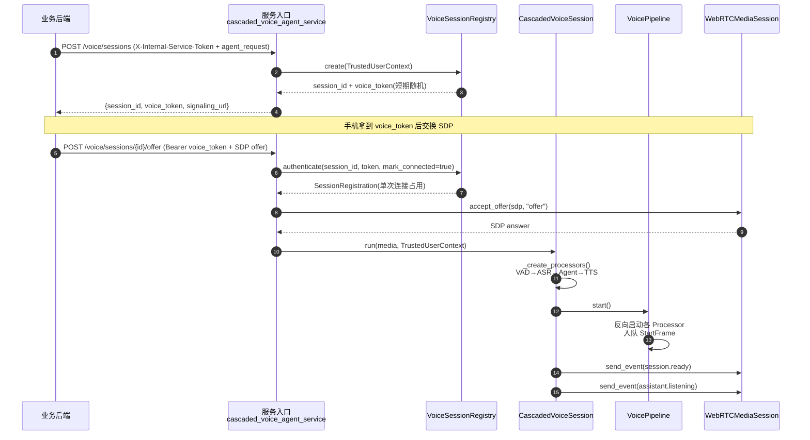
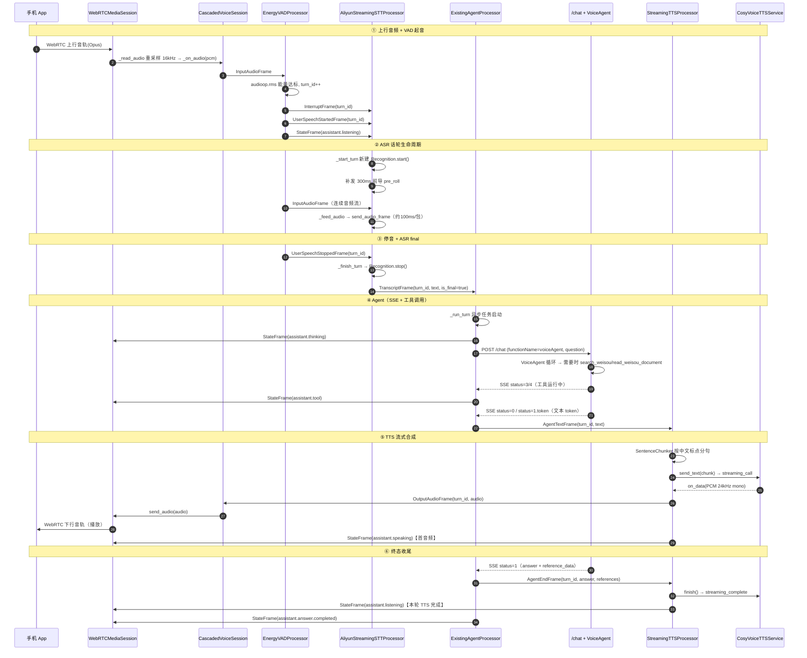
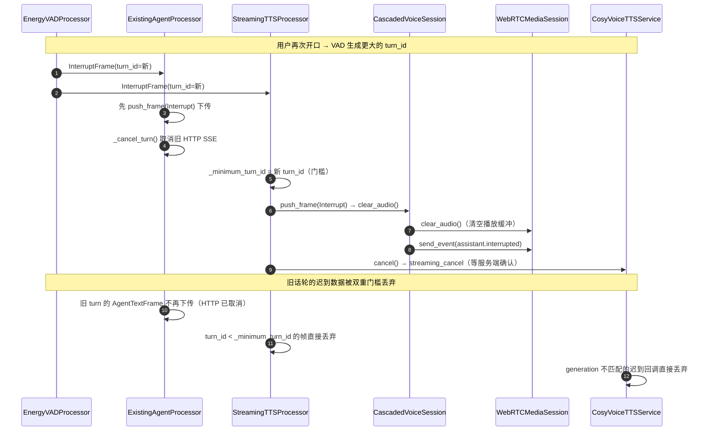
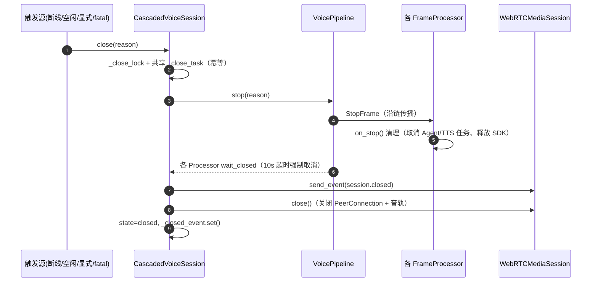

# 级联语音 Agent · 调用时序图

> 依据代码事实源：`qll_chat/cascaded_voice_agent/` 各模块 + `services/cascaded_voice_agent_service.py`。
> 参与者即真实类名，箭头即真实方法/帧。

---

## 一、会话建立



---

## 二、完整话轮（用户说一句 → 播报回答）



---

## 三、插话（打断）



---

## 四、关闭与资源释放



---

## 五、Frame 流转全景（ASCII）

```
手机App ──Opus──▶ WebRTCMediaSession ──16kHz PCM──▶ _on_audio ──InputAudioFrame──▶
EnergyVAD ──InterruptFrame/UserSpeechStarted/UserSpeechStopped──▶
AliyunStreamingSTT ──TranscriptFrame(is_final)──▶
ExistingAgentProcessor ──AgentTextFrame/AgentEndFrame/StateFrame──▶
StreamingTTSProcessor ──OutputAudioFrame/StateFrame──▶
CallbackProcessor ──▶ CascadedVoiceSession._handle_output ──▶ WebRTCMediaSession ──▶ 手机

    (中断) EnergyVAD ──InterruptFrame(新turn_id)──▶ 全链清空 + 取消
    (错误) 任意 Processor ──ErrorFrame──▶ session.error / fatal时关闭
```

---

## 六、关键机制与代码对应

| 机制 | 代码位置 | 作用 |
|---|---|---|
| 单调 `turn_id` | `vad.py` 生成、全程携带 | 隔离旧/新话轮 |
| `generation` 序号 | `aliyun_stt.py`、`cosyvoice_tts.py` | 丢弃取消后迟到回调 |
| SystemFrame 优先 | `processor.py` `queue_frame`（优先级 0/10） | 打断永远插队 |
| 后台任务可取消 | `existing_agent.py` `_cancel_turn`、`tts.py` `_cancel_turn` | 打断即取消 HTTP/TTS |
| 幂等关闭 | `session.py` `_close_lock`+`_close_task`、`pipeline.py` `_stop_task` | 多处触发只清理一次 |
| fail-closed 白名单 | `tool_policy.py`、`settings.py`、`contracts.py` | 工具/身份/ICE 默认拒绝 |
